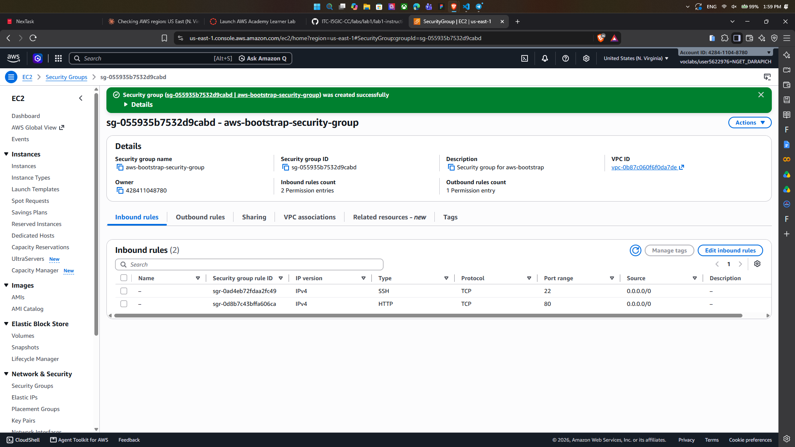
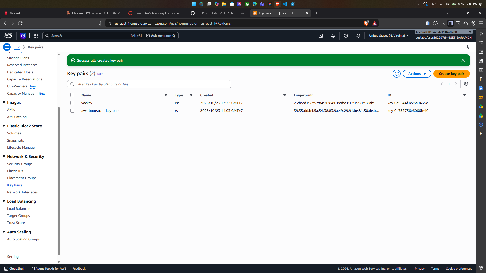
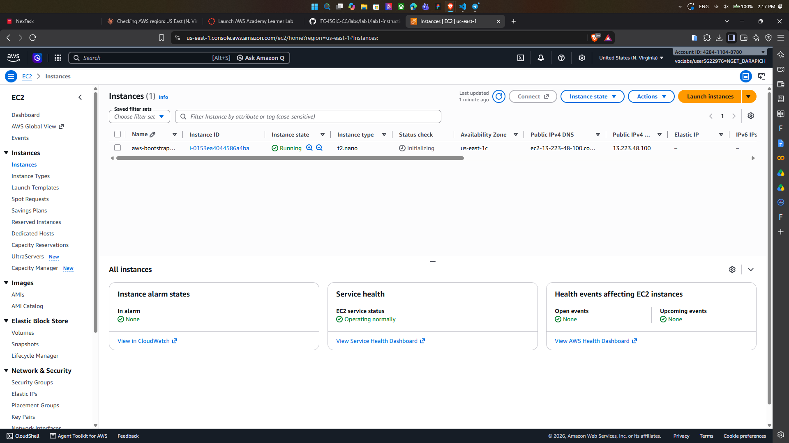
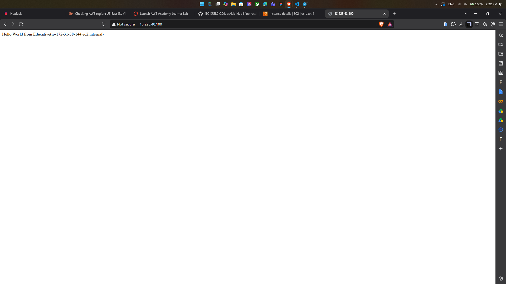
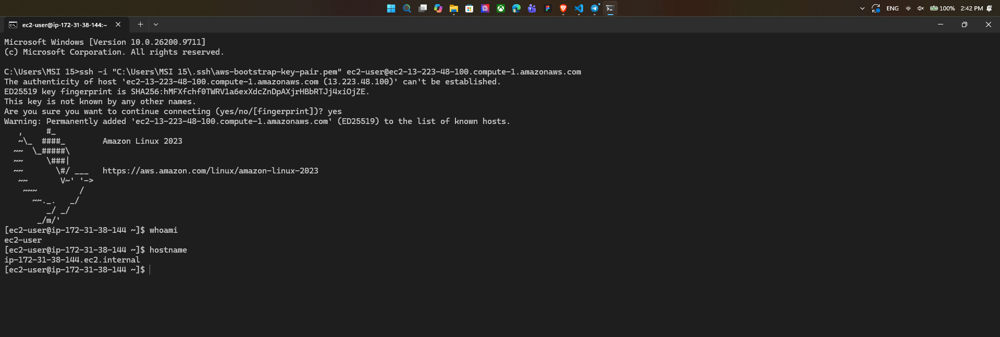
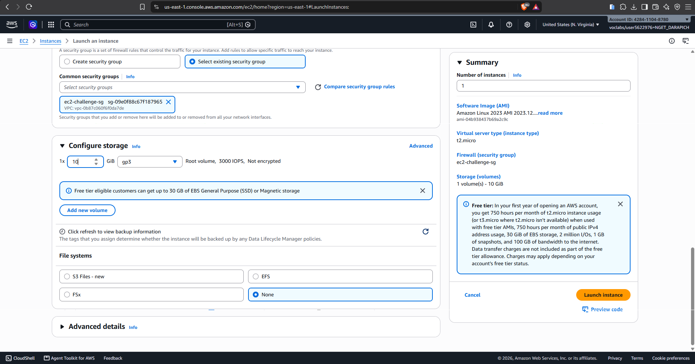
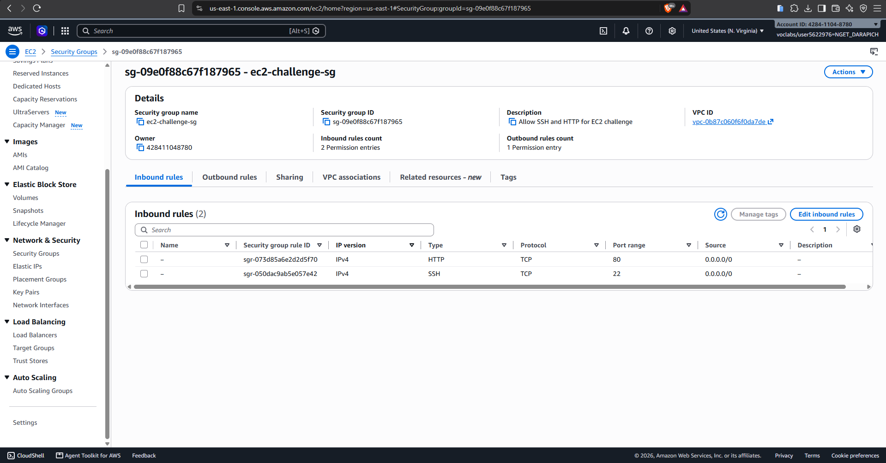
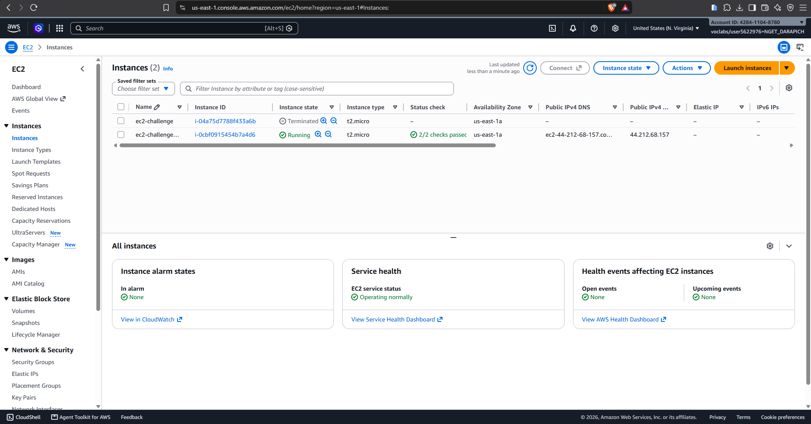
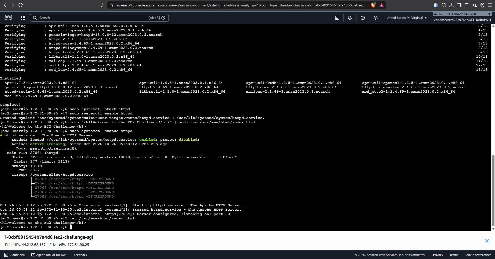
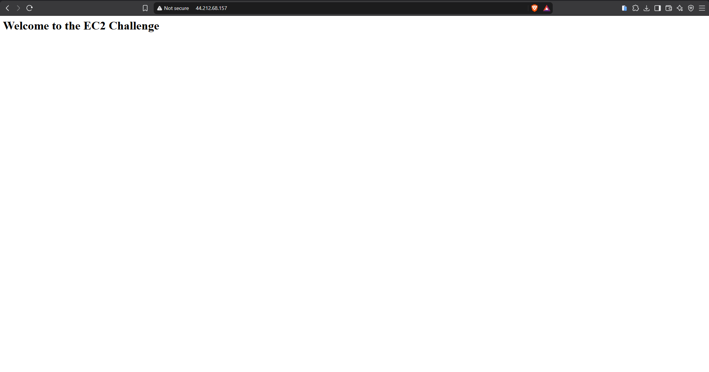

# Cloud Lab 1 Submission — Amazon EC2

Copy this template to `cc-lab-YOUR_ID/lab1/README.md` in your own repository. Follow [the instructions](lab1-instruction.md). Put your screenshots in `lab1/images/` with the file names below.

- **Student name: Nget Darapich**
- **Student ID: e20221646**
- **Learner Lab user name: voclabs/user5622976=NGET_DARAPICH**
- **Date completed: 26, October, 2026**

---

## Part 1.1 — An Amazon EC2 Walkthrough

### Security group



### Key pair



### Instance details



### Browser test



### SSH connection



Did you connect with your own SSH client or with EC2 Instance Connect?

---

## Part 1.2 — EC2 Web Solution (Challenge)

### Launch configuration



### Security group



### Running instance



### Commands on the instance



Paste the commands you ran to install the web server and create `index.html`:

```bash

```

### Browser test



---

## Questions

1. Your security group has an SSH rule and an HTTP rule. What does each one let you do? What would stop working if you deleted the HTTP rule?
2. In Part 1.1 you never logged in to install the web server. What installed it, and when did it run?
3. Why does the web page open with `http://` but not with `https://`?
4. Part 1.2 asked for a 10 GiB root volume. Where in the launch settings did you set it, and how can you check the size on the running instance?

## Answers

**1. SSH and HTTP rules**

The **SSH rule** (TCP port 22) lets you open a remote terminal on the instance, either from your own computer with `ssh -i key.pem ec2-user@<public-ip>` or through EC2 Instance Connect. You use it to manage the server. The **HTTP rule** (TCP port 80) lets browsers reach the web server running on the instance.

If you deleted the HTTP rule, the website would stop loading. The browser would hang and eventually time out, because the security group silently drops traffic to port 80. The web server would still be running, and you could still SSH in and run `curl localhost` to see the page. Only outside access would be blocked.

**2. What installed the web server**

The **user data** script did it. This is the script you pasted under *Advanced details → User data* when you launched the instance, something like `#!/bin/bash`, `yum install -y httpd`, `systemctl start httpd`. **cloud-init** runs this script automatically, as root, **once, during the instance's first boot**. That's why the web server was already installed when the instance reached "running" and passed its status checks. You can confirm it ran by checking `/var/log/cloud-init-output.log` on the instance.

**3. Why `http://` works but `https://` doesn't**

HTTPS uses port **443**, and two things are missing for it:
- The security group has no inbound rule for port 443, so the traffic is blocked before it reaches the instance.
- The web server has no TLS/SSL certificate configured and isn't listening on 443. So even if you opened the port, there would be nothing there to complete an HTTPS connection.

Plain HTTP works because port 80 is open and Apache serves it by default.

**4. The 10 GiB root volume**

You set it in the launch wizard under **Configure storage**, where you change the root volume (e.g. `/dev/xvda`, gp3) from the default 8 GiB to 10 GiB.

To check the size on the running instance:
- **In the console:** select the instance, open the **Storage** tab, and click the volume ID. The Volumes page shows its size as 10 GiB.
- **From inside the instance (via SSH):** `lsblk` shows the disk as about 10G, and `df -h /` shows the root filesystem at about 10G.

## Problems and how I solved them (optional)

## AI note (optional)

One suggestion an AI tool gave you and how you checked it.

## Clean up

- [ ] Part 1.1: instance terminated, key pair and security group deleted.
- [ ] Part 1.2: instance terminated, security group (and key pair, if any) deleted.
