# Cloud Lab 2 Submission — Load Balancer and Auto Scaling

Copy this template to `cc-lab-YOUR_ID/lab2/README.md` in your own repository. Follow [the instructions](lab2-instruction.md). Put your screenshots in `lab2/images/` with the file names below.

- **Student name: Nget Darapich**
- **Student ID: e20221646**
- **Learner Lab user name: voclabs/user5622976=NGET_DARAPICH**
- **Date completed: 30, October, 2026**

---

## Security groups

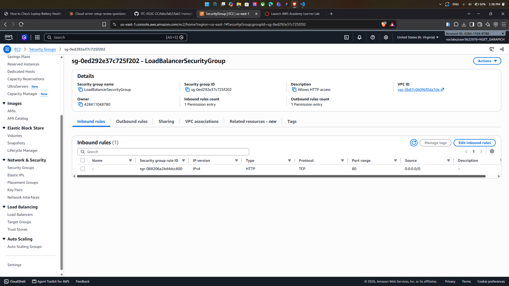

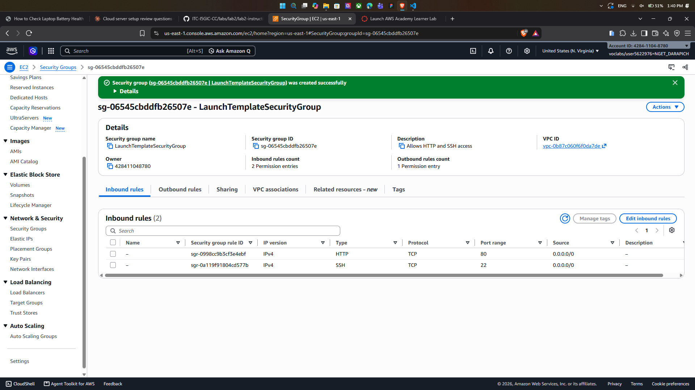

## Target group

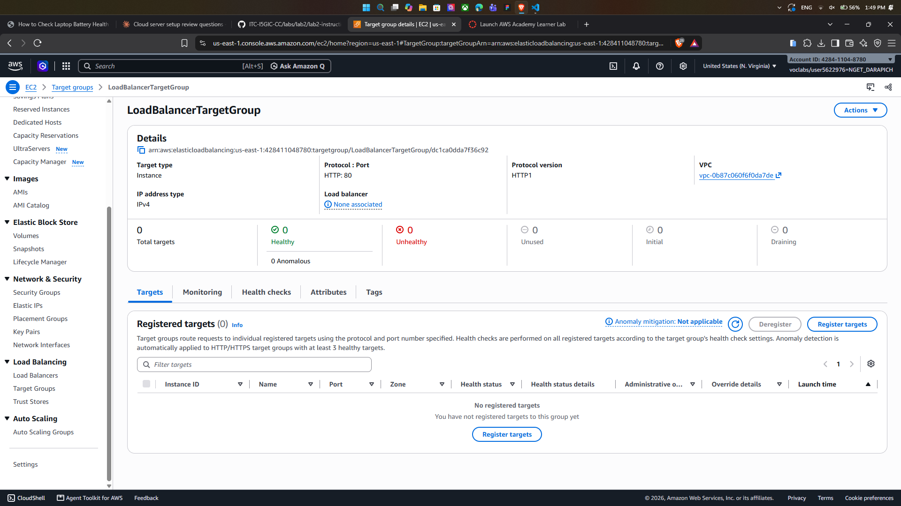

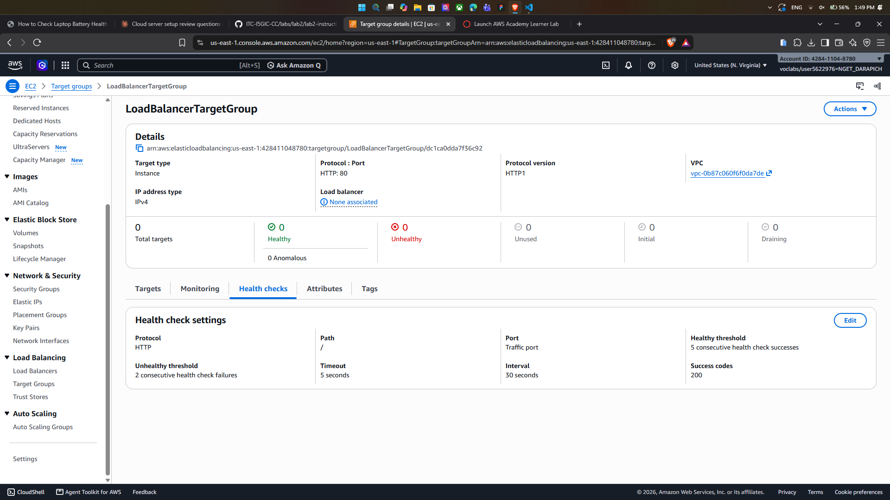

## Application Load Balancer

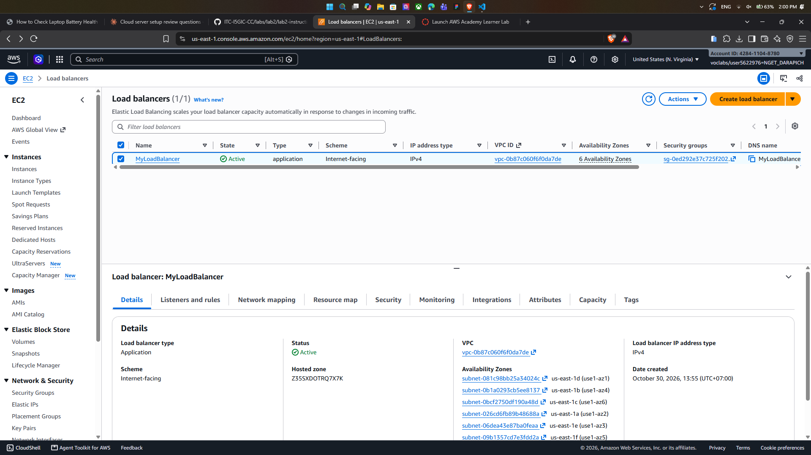

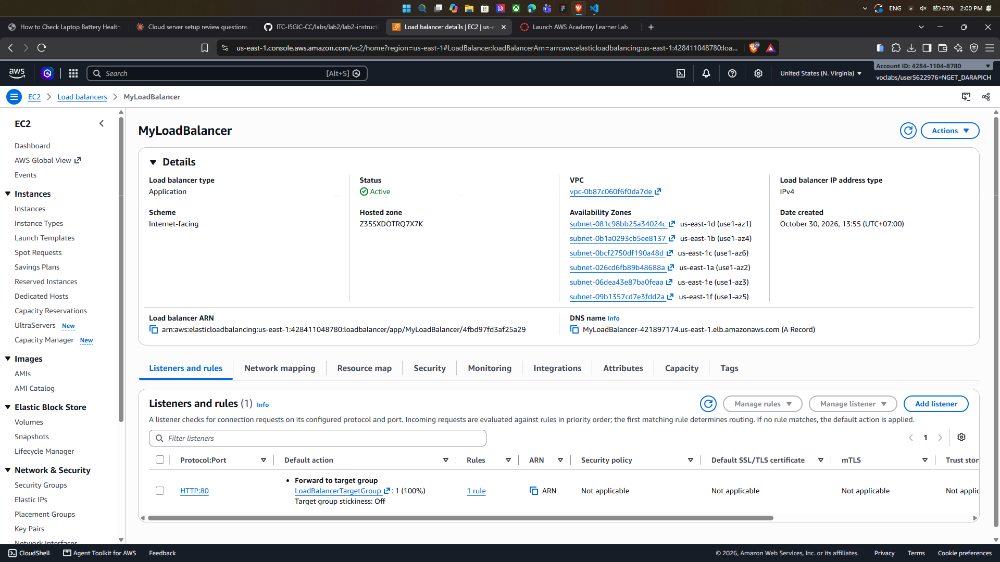

## Launch template

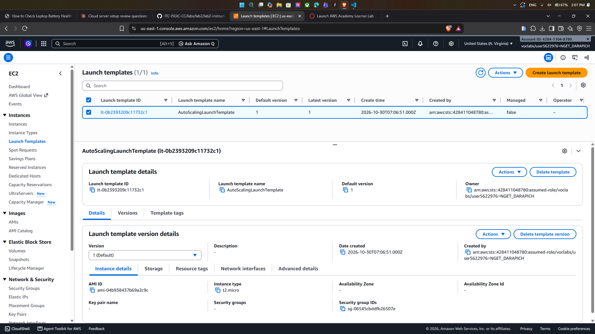

## Auto Scaling group

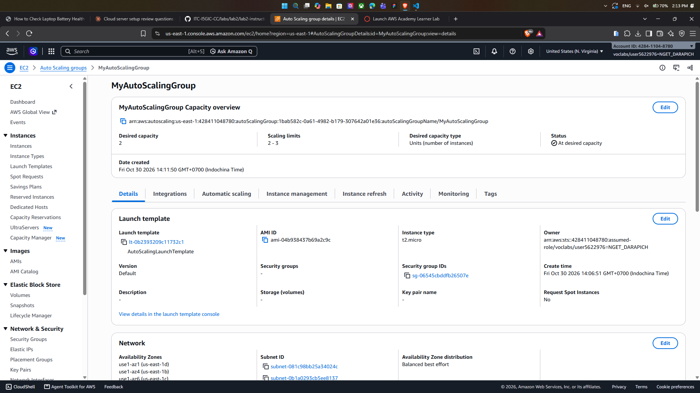

## Load balancing test

## Simulated application failure

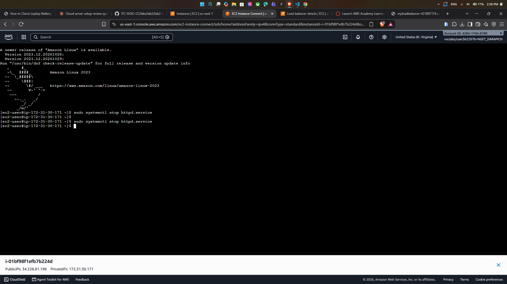

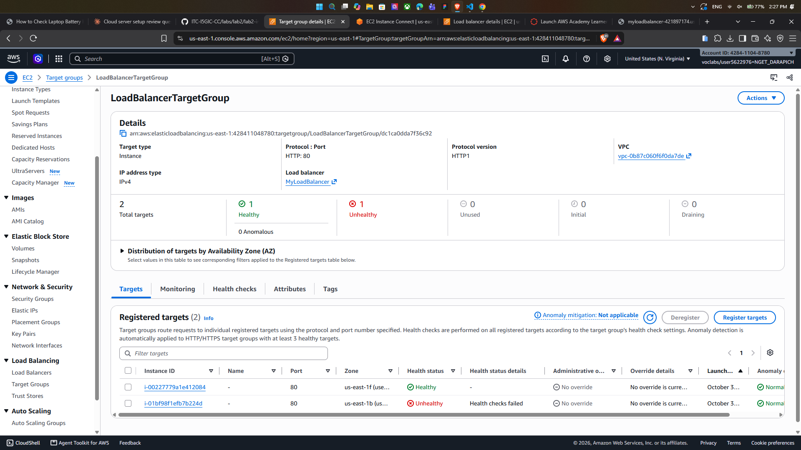

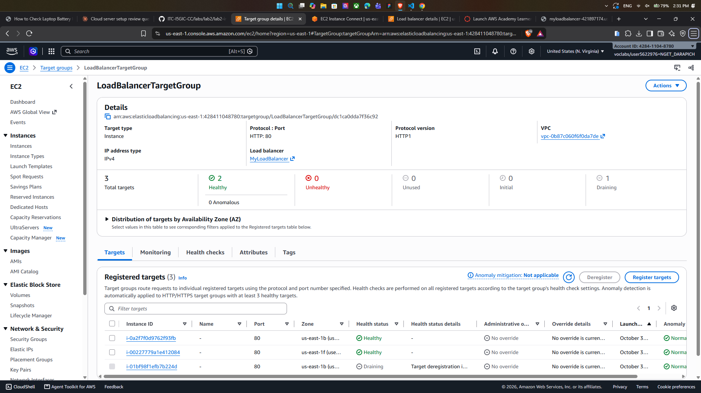

About how many minutes passed between stopping `httpd` and the new instance becoming healthy?

---

## Questions

1. Why does the page show a different host name when you refresh it?
2. After you stopped `httpd`, the instance was still *running* in EC2, but the target group marked it *unhealthy*. What did the health check test, and why did the instance fail it?
3. Who replaced the failed instance: the load balancer, the target group, or the Auto Scaling group? Explain the role of each one.
4. With desired 2, minimum 2 and maximum 3, how many instances run normally? In what situation could there be 3?
5. The instances' security group allows HTTP from anywhere. How could you change it so that the instances accept HTTP **only** from the load balancer?

**1. Why the host name changes on refresh**

The load balancer spreads requests across the healthy instances in the target group. By default it uses round robin, so consecutive requests usually land on different instances. Each instance's page was generated by its user data script and shows that instance's own host name, so the name changes as different instances answer. With 2 instances, you'll typically see it alternate between them.

**2. What the health check tested**

The target group's health check regularly sends an **HTTP request (GET `/` on port 80, by default) to each instance** and expects a successful response (HTTP 200). After you stopped `httpd`, nothing was listening on port 80, so the request was refused. After a few consecutive failures (the unhealthy threshold), the target group marked the instance **unhealthy** and the load balancer stopped sending it traffic.

EC2 still showed the instance as *running* because EC2's own status checks only test the hardware, the network, and whether the OS is reachable. They don't check whether your web application works. The instance was fine; only the application on it was down.

**3. Who replaced the failed instance**

The **Auto Scaling group** replaced it.

- The **load balancer** is the single entry point (the DNS name). It receives client requests and forwards them, using listener rules, to a target group. It never creates or deletes instances.
- The **target group** is the list of registered instances. It runs the health checks and tells the load balancer which targets are healthy enough to receive traffic. It only marks instances healthy or unhealthy; it doesn't replace them.
- The **Auto Scaling group** keeps the right number of healthy instances running. Because its health check type includes **ELB** health checks, it saw the target group's "unhealthy" result, terminated that instance, and launched a new one from the launch template. It then registered the new instance in the target group automatically.

If the Auto Scaling group used only EC2 health checks, it would *not* have replaced the instance, because the instance was still "running."

**4. Desired 2, minimum 2, maximum 3**

Normally **2** instances run, because the Auto Scaling group always works to match the *desired* capacity. There could be **3** when the desired capacity goes up to 3:
- **A scaling policy fires.** For example, a target-tracking policy sees average CPU go above its target and scales out to handle the extra load.
- **You manually** change the desired capacity to 3.

Maximum 3 is a hard ceiling: scaling can never go beyond it. Minimum 2 is the floor: it can never scale in below 2.

**5. Allowing HTTP only from the load balancer**

In the **instances'** security group, edit the inbound HTTP rule. Change the source from `0.0.0.0/0` to the **load balancer's security group ID** (`sg-…`).

- The **load balancer's** security group keeps HTTP (port 80) open from `0.0.0.0/0`, so the public can still reach the site through the load balancer's DNS name.
- The instances then accept port 80 traffic only from network interfaces that belong to the load balancer's security group. Opening an instance's public IP directly in a browser will time out.

Remove the old `0.0.0.0/0` HTTP rule as well, or it will still allow everyone in. This kind of security-group-to-security-group reference is also one of the things that blocks deleting a security group, as in your earlier question.

## Problems and how I solved them (optional)

## AI note (optional)

One suggestion an AI tool gave you and how you checked it.

## Clean up

- [ ] `MyAutoScalingGroup` deleted and its instances terminated.
- [ ] `AutoScalingLaunchTemplate` deleted.
- [ ] `MyLoadBalancer` and `LoadBalancerTargetGroup` deleted.
- [ ] Both security groups deleted.
