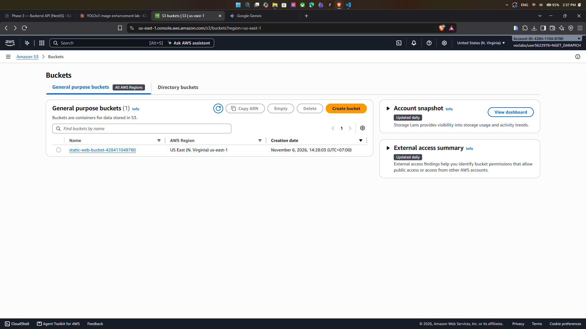
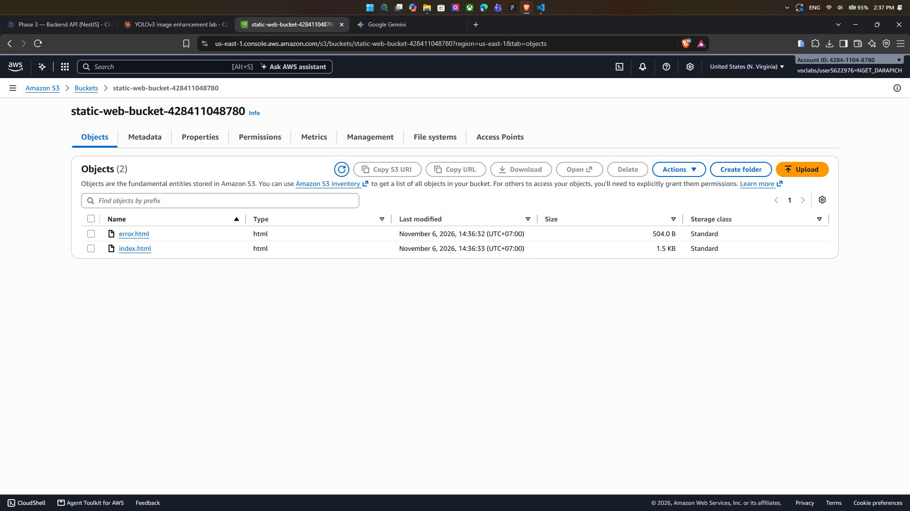
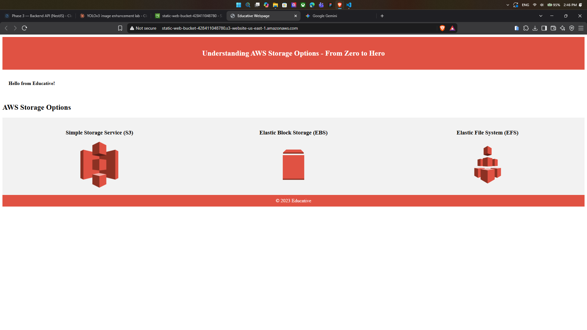
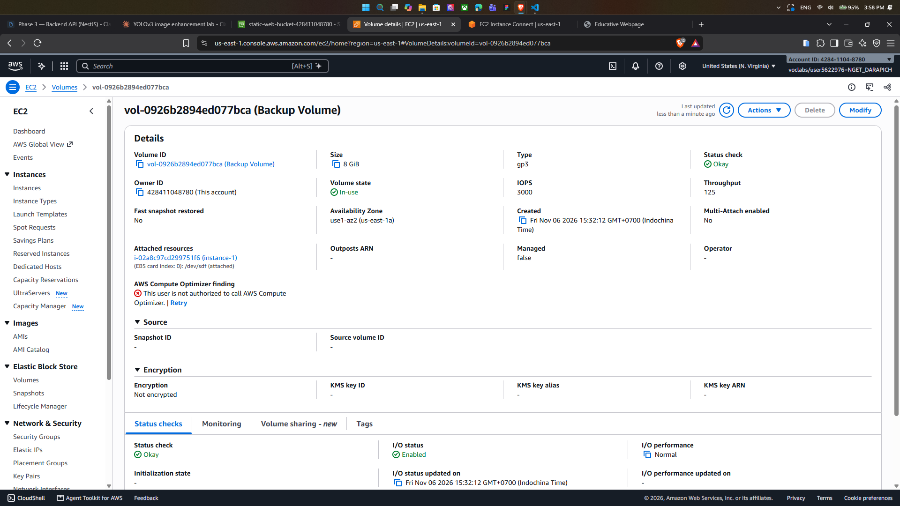
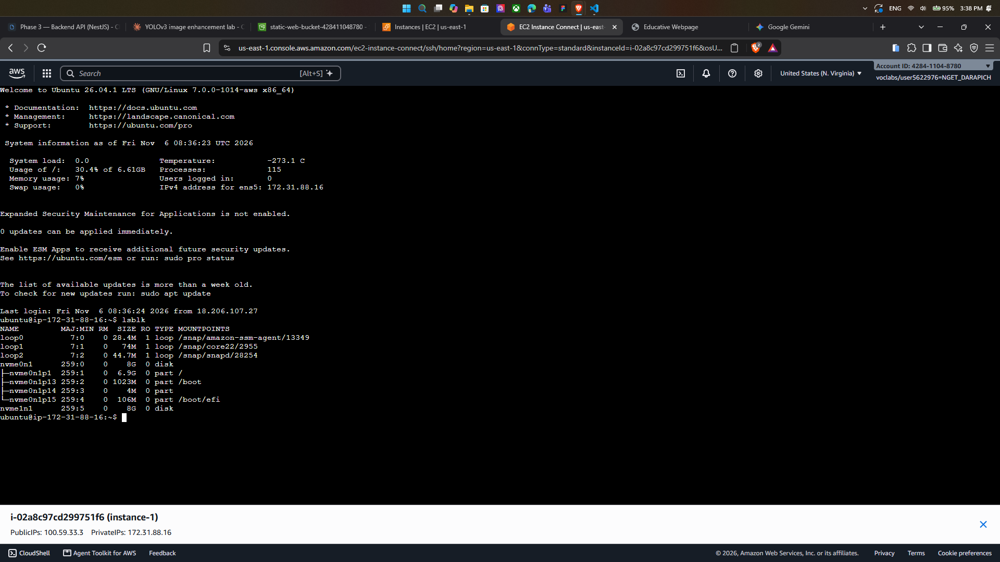
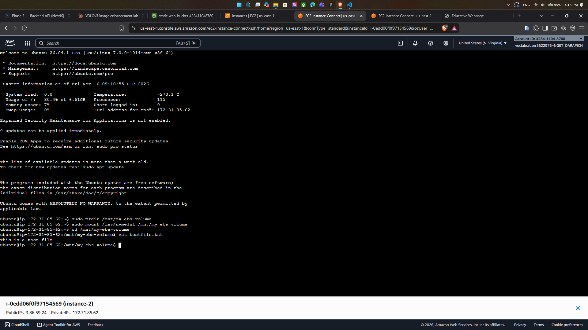
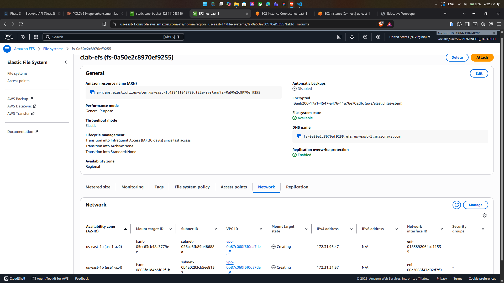
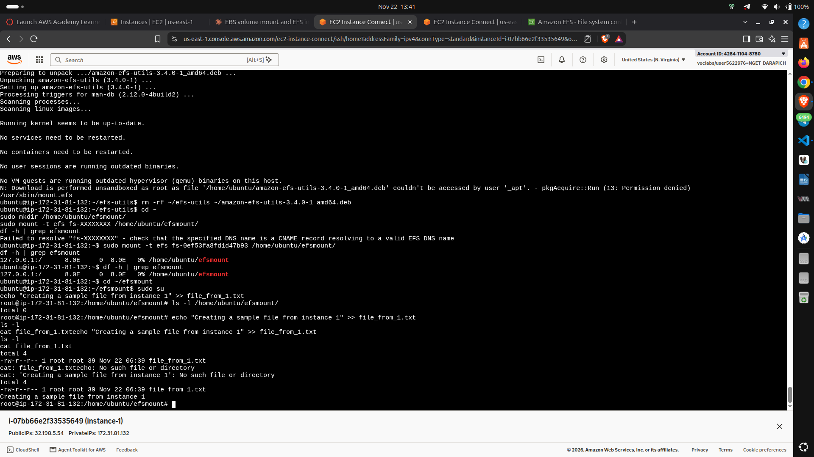
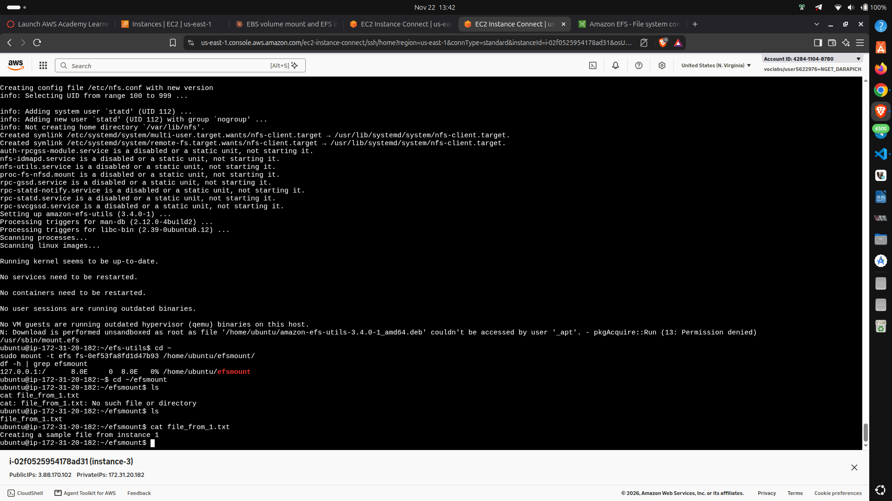

# Cloud Lab 3 Submission — AWS Storage Options

Copy this template to `cc-lab-YOUR_ID/lab3/README.md` in your own repository. Follow [the instructions](lab3-instruction.md). Put your screenshots in `lab3/images/` with the file names below.

- **Student name: Nget Darapich**
- **Student ID: e20221646**
- **Learner Lab user name: voclabs/user5622976=NGET_DARAPICH**
- **Date completed: 22, November, 2026**

---

## Part 2.1 — Amazon S3

### Bucket list

### Uploaded files

### Static website

---

## Part 2.2 — Amazon EBS

### Volumes page

### Attached volume (`lsblk`)

Which device name did your volume get (`xvdf`, `nvme1n1`, ...)?

### File read on instance-2

---

## Part 2.3 — Amazon EFS

### File system and mount targets

### File created on instance-1

### File listed on instance-3

---

## Questions

1. After you turned on static website hosting, the endpoint first answered **403 Forbidden**. Why, and what changed after you added the bucket policy?
2. `testfile.txt` was still there after you moved **Backup Volume** to `instance-2`. What would have happened to a file saved on `instance-1`'s **root** volume after terminating `instance-1`?
3. Why did you run `mkfs` on `instance-1` but not on `instance-2`?
4. Why could `instance-1` and `instance-3` use the EFS file system at the same time, when an EBS volume had to be detached first? Why did they have to be in the subnets of the mount targets?
5. For each need, choose S3, EBS or EFS and give one reason: (a) a website's images, (b) the disk of a database server, (c) a folder shared by several web servers.

## Answers

1. **403 Forbidden on the website endpoint**
   S3 buckets and objects are private by default, and Block Public Access was on, so anonymous visitors had no permission to read the files. Enabling static website hosting only gives the bucket a website endpoint. It does not grant read access. After I turned off Block Public Access and added a bucket policy allowing `s3:GetObject` for everyone (`"Principal": "*"`) on `arn:aws:s3:::<bucket>/*`, anonymous requests were allowed and the endpoint returned `index.html` (200 OK).

2. **File on instance-1's root volume after termination**
   It would be lost. The root EBS volume is created with **Delete on termination** enabled by default, so terminating `instance-1` deletes the root volume and everything on it. Backup Volume was a separate EBS volume. It is not deleted with the instance and can be detached and attached to another instance, which is why `testfile.txt` survived.

3. **Why `mkfs` on instance-1 but not instance-2**
   `mkfs` creates a new, empty filesystem. The volume was blank when first attached to `instance-1`, so it needed formatting before it could be mounted. When it was moved to `instance-2`, it already had an ext4 filesystem with `testfile.txt` on it. Running `mkfs` again would have erased the data, so on `instance-2` we only create the mount point and mount it.

4. **EFS shared vs EBS single-attach; subnets of mount targets**
   EBS is block storage attached to one instance at a time (like a local disk), and the filesystem on it is managed by that one instance's OS, so it must be detached before another instance can use it. EFS is a managed network file system that uses the NFS protocol. The EFS service manages the filesystem and file locking, so many instances can mount and read/write it at the same time.
   Instances reach EFS through a **mount target**, which is a network interface with an IP address in a specific subnet/Availability Zone of the VPC. The instance connects to the mount target over NFS (port 2049, allowed by `efs-sg`), and the file system's DNS name resolves to the mount target in the instance's AZ. Without a mount target reachable in its subnet/AZ, the instance cannot connect to the file system.

5. **Choosing storage**
   - **(a) Website images → S3:** object storage that is cheap, highly durable, scales without limit, and can serve files directly over HTTP (or via CloudFront) without any server.
   - **(b) Database server disk → EBS:** low-latency block storage attached to one instance, with consistent IOPS (e.g. gp3/io2) that a database needs for its data files.
   - **(c) Folder shared by several web servers → EFS:** a shared file system that many instances can mount and read/write at the same time, so all servers see the same files.

## Problems and how I solved them (optional)

## AI note (optional)

One suggestion an AI tool gave you and how you checked it.

## Clean up

- [ ] Instances `instance-1`, `instance-2`, `instance-3` terminated.
- [ ] `clab-efs` and **Backup Volume** deleted.
- [ ] Security groups `efs-sg` and `ec2instances-sg` deleted.
- [ ] S3 bucket emptied and deleted.
