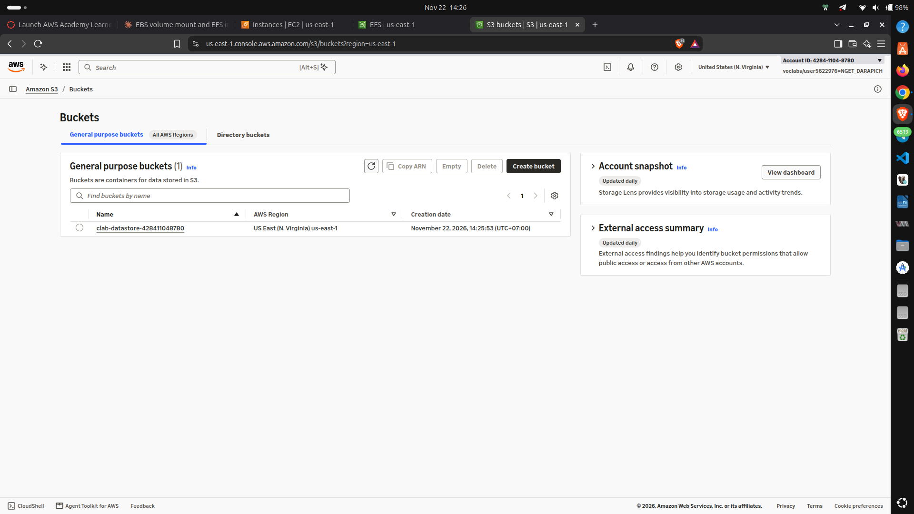
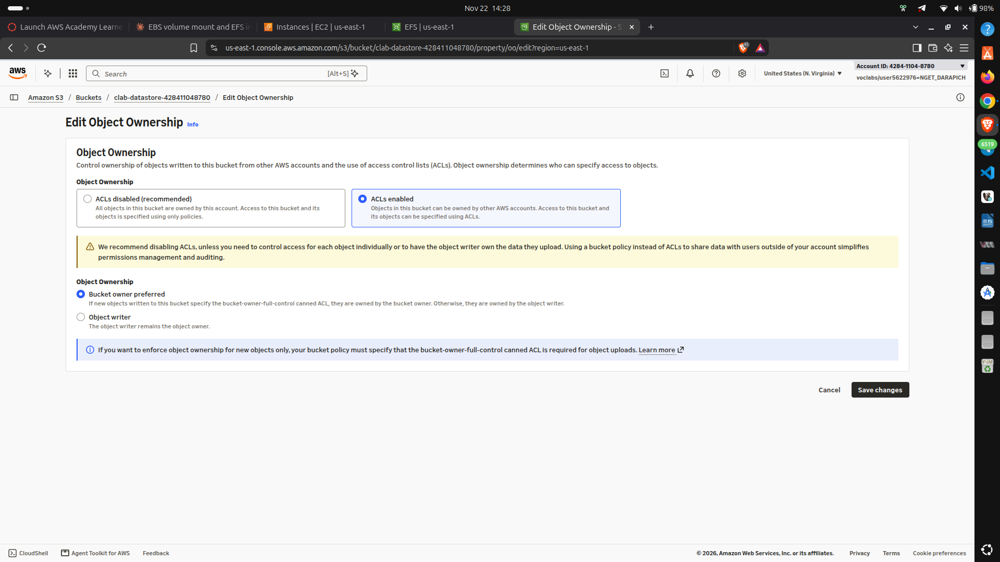
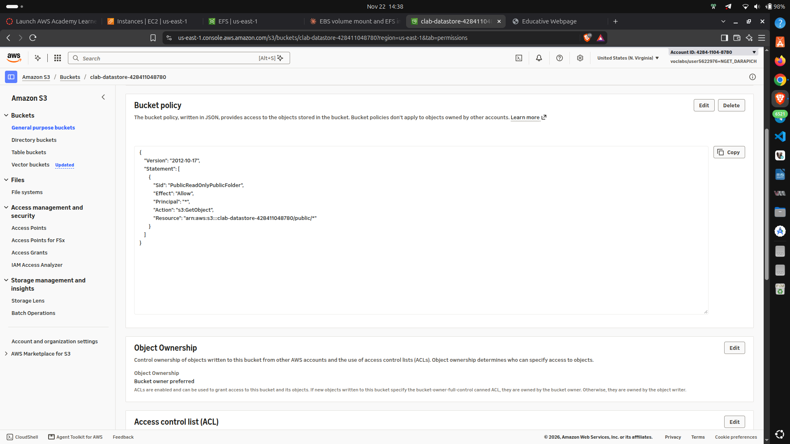
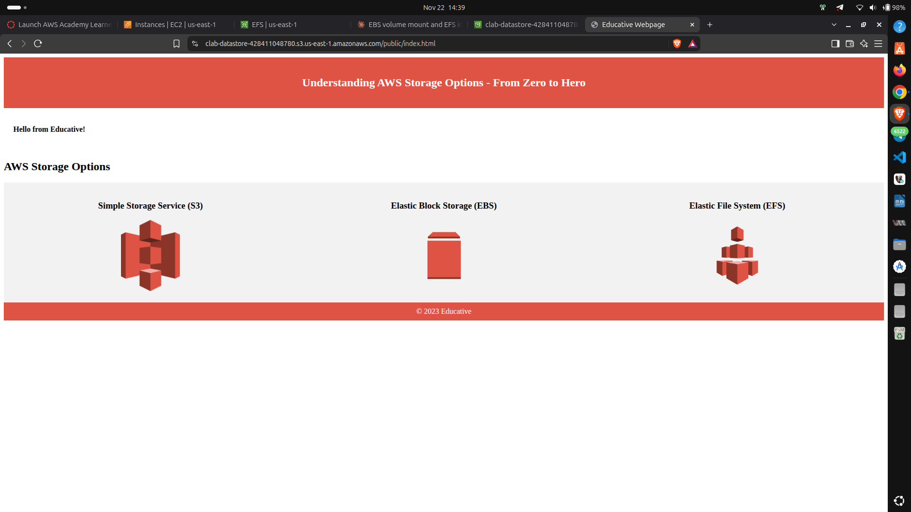
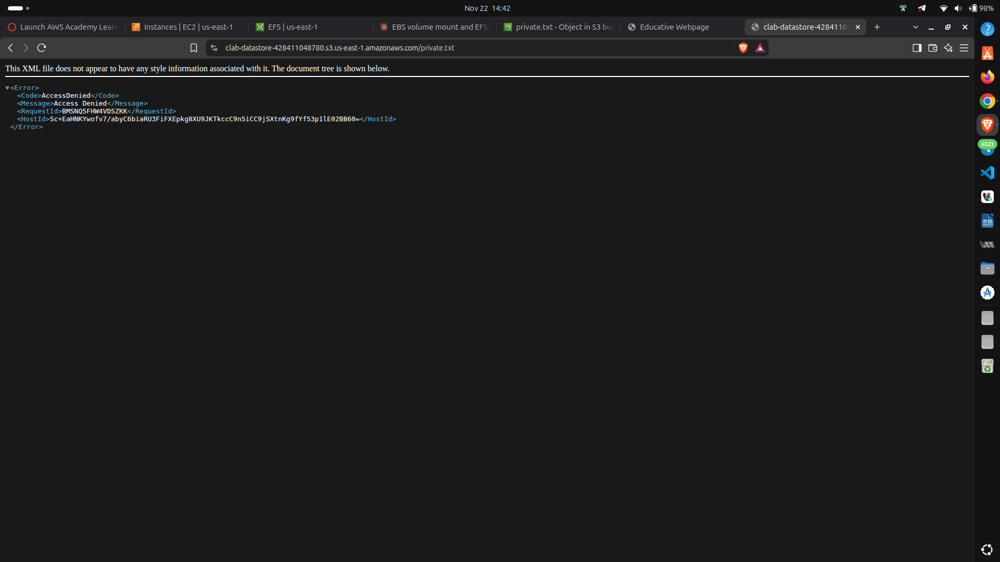
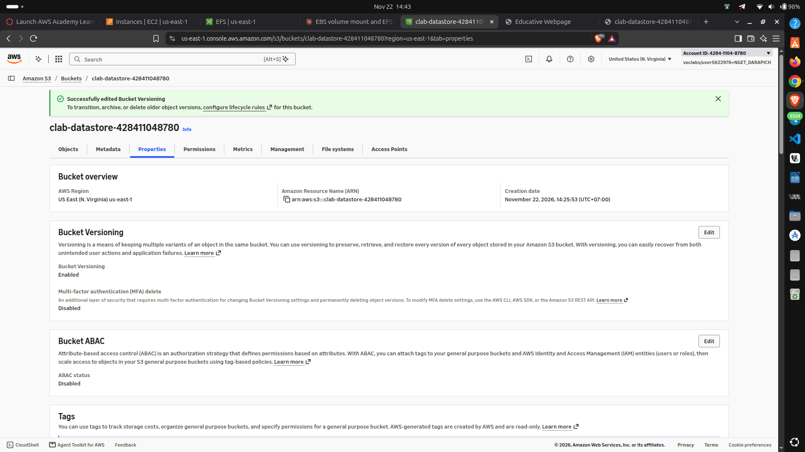
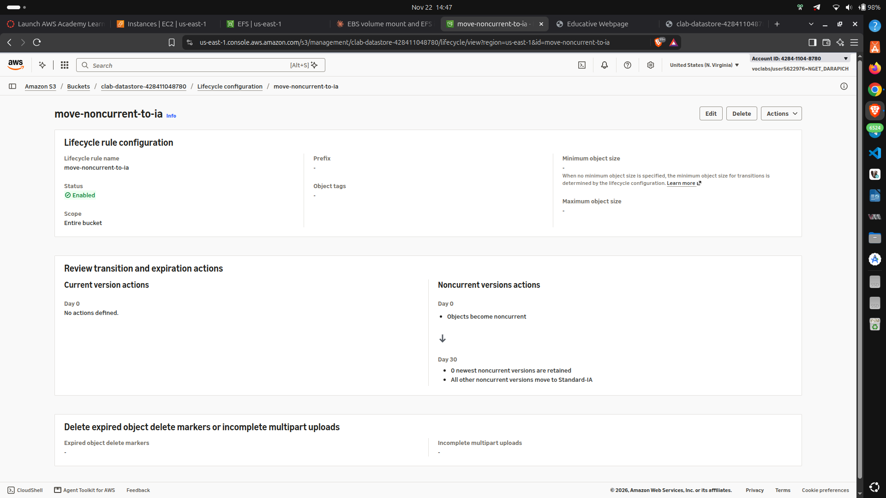

# Cloud Lab 3 Challenge Submission — Secure S3 Bucket

Copy this template to `cc-lab-YOUR_ID/lab3-challenge/README.md` in your own repository. Follow [the challenge](lab3-challenge.md). Put your screenshots in `lab3-challenge/images/` and your policy in `lab3-challenge/bucket-policy.json`.

- **Student name: Nget Darapich**
- **Student ID: e20221646**
- **Learner Lab user name: voclabs/user5622976=NGET_DARAPICH**
- **Date completed: 22, November, 2026**

---

## 1. Bucket

## 2. Object ownership

## 3. Public access policy

My policy is in [bucket-policy.json](bucket-policy.json). Explain which line limits public access to the `public/` folder:

## 4. Versioning

## 5. Lifecycle rule

---

## Questions

1. You turned off parts of **Block Public Access** for this bucket. Why was that needed, and why is it still safe for the objects outside `public/`?
2. What is a **noncurrent version**? Give an example from your own test.
3. Why move noncurrent versions to S3 Standard-IA instead of deleting them?

## Answers

1. **Why turn off parts of Block Public Access, and why is it still safe?**
   Block Public Access overrides bucket policies. With "Block public access granted through new/any public bucket policies" turned on, S3 refuses to save or apply any policy with `"Principal": "*"`, so `public/index.html` could not be made readable by everyone. I turned off only the two **bucket policy** settings and kept the two **ACL** settings on.
   It is still safe for everything outside `public/` because S3 is **private by default**: an object can only be read if a policy or ACL explicitly allows it. My bucket policy allows `s3:GetObject` only on `arn:aws:s3:::clab-datastore-428411048780/public/*`, so nothing else is granted. Because the ACL blocks are still on, no one can make a single object public with an ACL either. The test confirmed it: `public/index.html` loaded, but `private.txt` at the bucket root returned **AccessDenied**.

2. **What is a noncurrent version?**
   With versioning enabled, S3 keeps every version of an object under the same key. The latest one is the **current version**, and it is what you get when you open the object. Every older version that has been replaced (or hidden by a delete marker) is a **noncurrent version**. It is still stored and can be restored.
   Example: I uploaded `public/index.html`, edited the file, and uploaded it again with the same name. The second upload became the current version (the one the Object URL shows), and the first upload became a noncurrent version, visible with **Show versions** and with its own version ID.

3. **Why move noncurrent versions to Standard-IA instead of deleting them?**
   Old versions are rarely needed, but they are the backup if someone overwrites or deletes a page by mistake, so deleting them would lose the ability to roll back. S3 Standard-IA (Infrequent Access) has a much lower storage price than S3 Standard and the same durability, with a small fee only when data is retrieved. Moving noncurrent versions there after 30 days cuts storage cost while keeping the history available for recovery. (A later rule could still delete very old versions if they are no longer needed.)

## AI note (optional)

One suggestion an AI tool gave you and how you checked it.

## Clean up

- [ ] All object versions deleted and the bucket deleted.
