# Cloud Lab 4 Submission — Amazon VPC

- **Student name:** Nget Darapich
- **Student ID:** e20221646
- **Learner Lab user name:** voclabs/user5622976=NGET_DARAPICH
- **Date completed:** 23 November 2026

---

## VPC and internet gateway

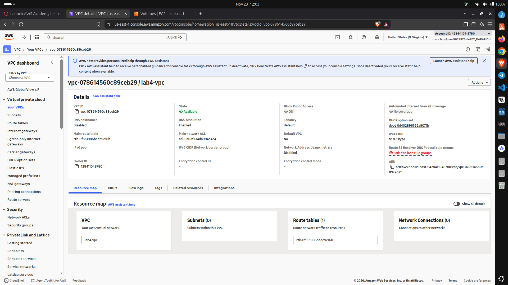

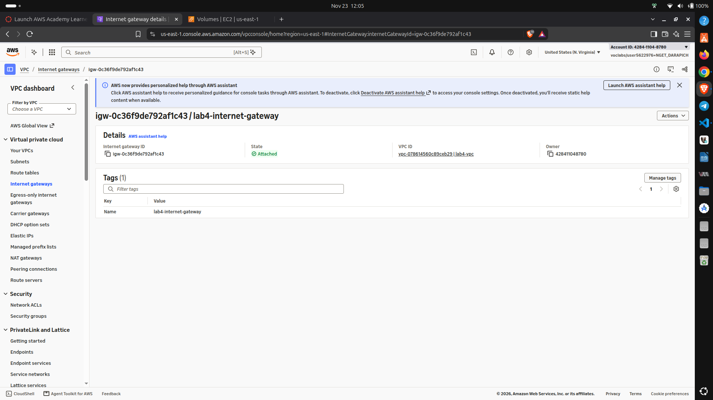

## Public subnet

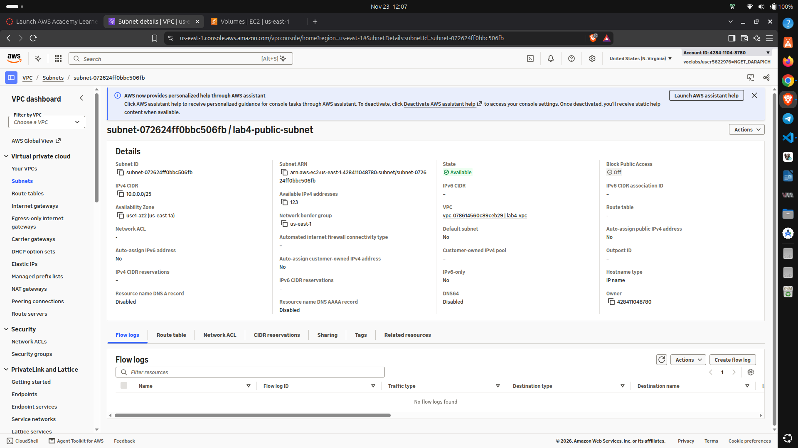

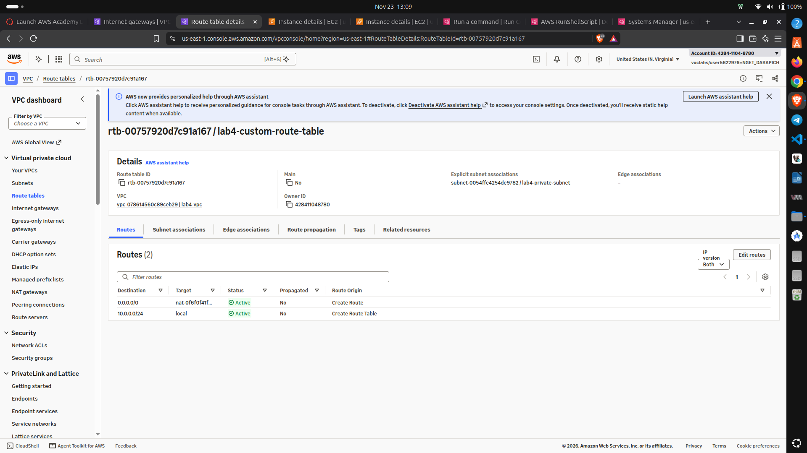

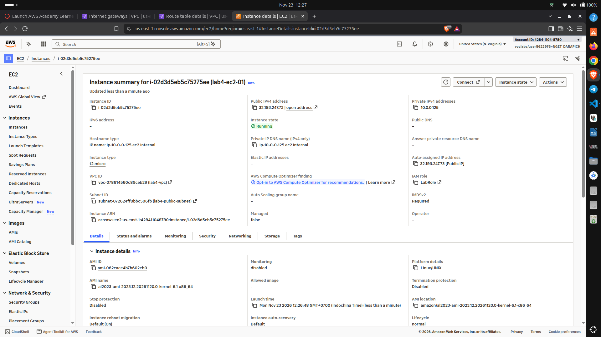

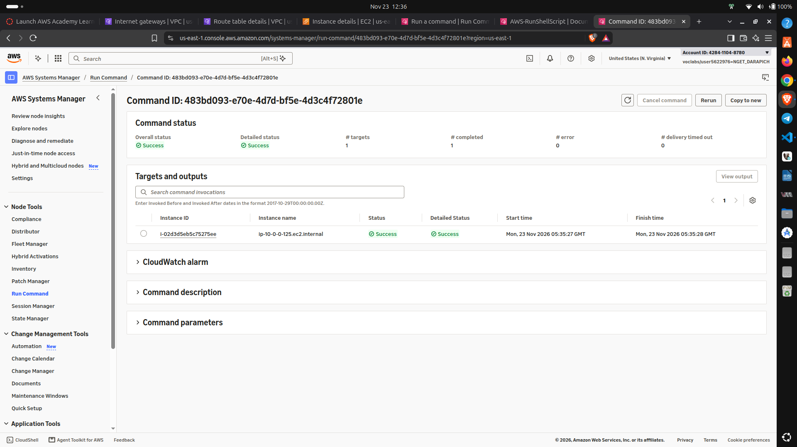

## Private subnet

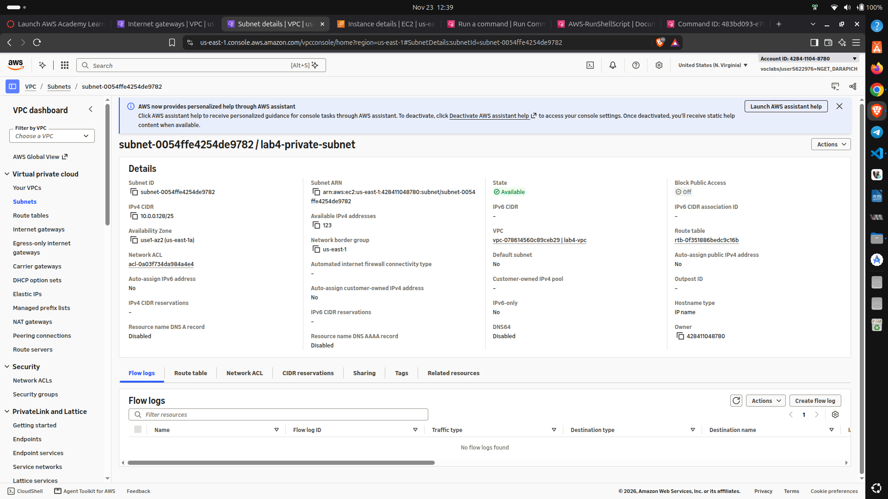

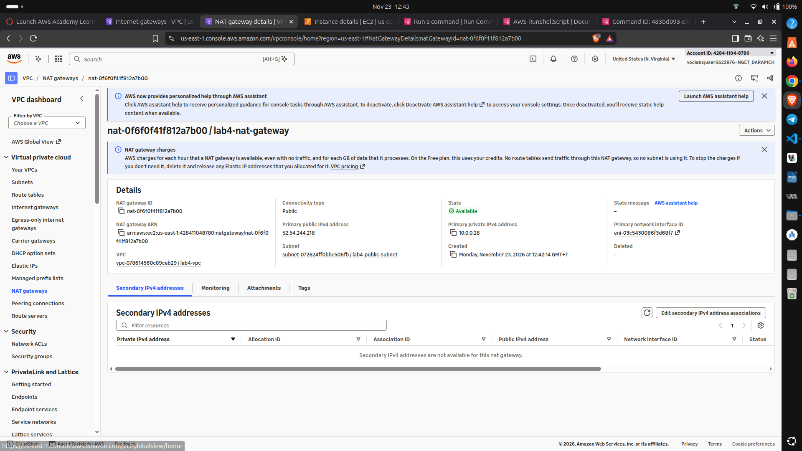

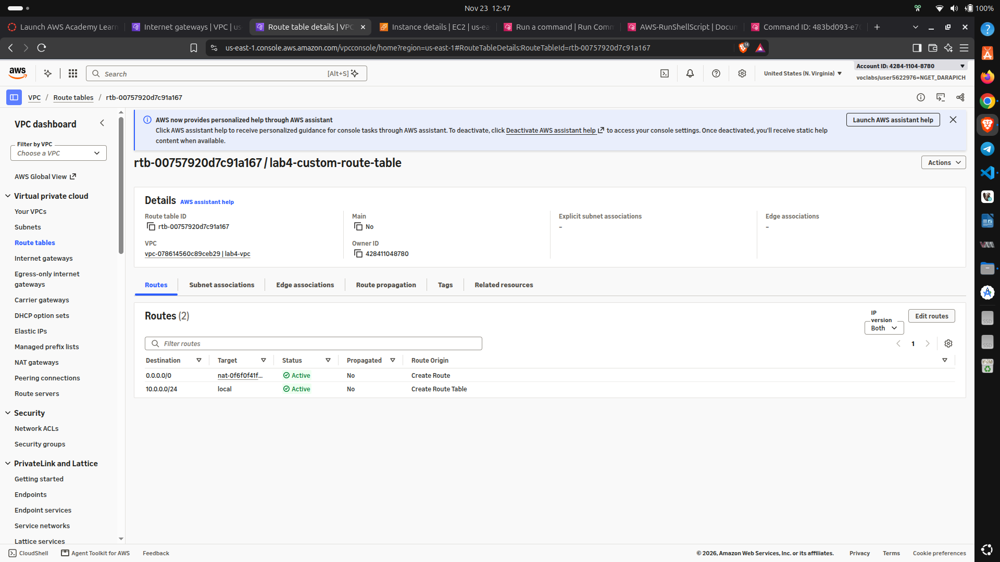

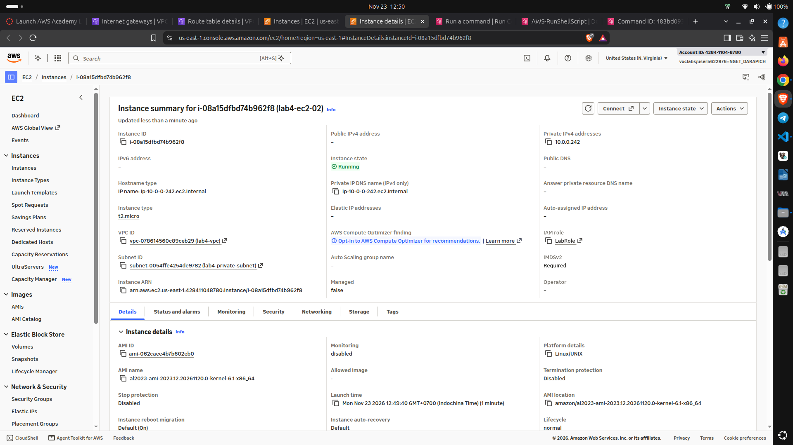

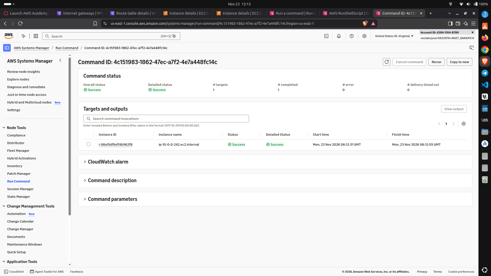

---

## Questions

1. The VPC is `10.0.0.0/24` and the subnets are `10.0.0.0/25` and `10.0.0.128/25`. How many IP addresses does each block contain, and why do the two subnets not overlap?
2. Both subnets are in the same VPC. What exactly makes `lab4-public-subnet` public and `lab4-private-subnet` private?
3. Why is the NAT gateway placed in the **public** subnet and not in the private one?
4. `lab4-ec2-02` has no public IP address. Can someone on the internet open a connection to it? Can it download updates? Explain both answers.
5. You tested internet access with Systems Manager instead of SSH. Why did the instances need `LabInstanceProfile` for this?

## Answers

1. **How many IP addresses, and why don't the subnets overlap?**
   A block with prefix `/n` contains 2^(32 − n) addresses:
   - `10.0.0.0/24` → 2^8 = **256** addresses (`10.0.0.0` – `10.0.0.255`)
   - `10.0.0.0/25` → 2^7 = **128** addresses (`10.0.0.0` – `10.0.0.127`)
   - `10.0.0.128/25` → 2^7 = **128** addresses (`10.0.0.128` – `10.0.0.255`)

   The `/25` adds one more network bit, which splits the `/24` exactly in half. The first subnet takes the lower half (last octet 0–127) and the second takes the upper half (128–255), so no address is in both. Together they use the whole VPC range. In each subnet AWS reserves 5 addresses (network address, VPC router, DNS, future use, broadcast), so **123** are usable for instances.

2. **What makes one subnet public and the other private?**
   Only the **route table** associated with the subnet. `lab4-public-subnet` uses a route table with `0.0.0.0/0 → internet gateway`, so its instances (with a public IP) can send traffic directly to and from the internet. `lab4-private-subnet` uses a route table where `0.0.0.0/0` points to the **NAT gateway** (or has no internet route at all), so there is no direct path from the internet to it. Auto-assigning public IPs in the public subnet is needed for instances to be reachable, but the internet gateway route is what makes the subnet public.

3. **Why is the NAT gateway in the public subnet?**
   The NAT gateway itself must reach the internet. It has an Elastic IP and sends traffic out through the **internet gateway**, which is only possible from a subnet whose route table has `0.0.0.0/0 → igw`. Private instances send their internet traffic to the NAT gateway, and the NAT gateway forwards it through the internet gateway using its own public IP. If it were in the private subnet, its traffic would be routed back to itself and nothing could leave the VPC.

4. **Can the internet reach `lab4-ec2-02`? Can it download updates?**
   - **Inbound: no.** It has no public IP address, and its subnet has no route from the internet gateway. A NAT gateway only allows connections *started from inside* and does not forward new incoming connections, so nobody on the internet can open a connection to it.
   - **Outbound: yes.** When it runs `yum update`, the request goes to the NAT gateway (private route table: `0.0.0.0/0 → nat`). The NAT gateway replaces the private source IP with its Elastic IP, sends the request out through the internet gateway, and returns the replies to the instance. That is why the Run Command test showed **Success**.

5. **Why did the instances need `LabInstanceProfile`?**
   Run Command works through the **SSM Agent** on the instance, which connects outbound to the Systems Manager service and must authenticate with AWS credentials. `LabInstanceProfile` attaches an IAM role (with the `AmazonSSMManagedInstanceCore` permissions) that gives the instance temporary credentials to register as a managed node and receive commands. Without it, the instance never appears in Run Command. It also meant I didn't need SSH keys, port 22 open, or a public IP, so the private instance could be tested even though it is unreachable from the internet.

## Problems and how I solved them (optional)

- **`lab4-ec2-02` did not appear in Run Command → Choose instances manually.** A private instance can only register with Systems Manager through the NAT gateway, so I checked the path: NAT gateway *Available* in the public subnet, private route table with `0.0.0.0/0 → nat-…` and associated with the private subnet, and `LabInstanceProfile` attached to the instance. <!-- Write what you actually fixed, e.g. "the private subnet was still using the main route table" / "I rebooted the instance" -->

## AI note (optional)

## Clean up

- [ ] Instances terminated.
- [ ] NAT gateway deleted and its Elastic IP released.
- [ ] Internet gateway detached and deleted.
- [ ] `lab4-vpc` deleted.